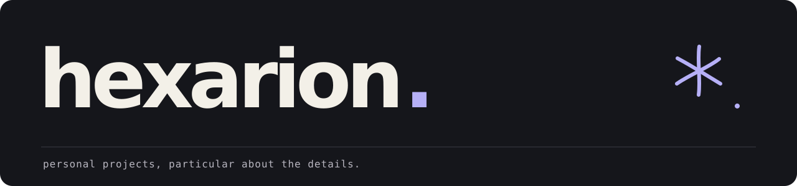

 

**Python · Linux · Personal projects**

 

I'm **Hexarion**. I build things I want to use, then keep refining the details until they feel like mine.

I'm into **Arch Linux**, **Hyprland**, assistants, automation, and self-hosting.

## A few things I'm building

| Project | What it does |
| :--- | :--- |
| **[CIEL](https://github.com/Hexarion0/Ciel)** | A voice assistant for Linux with spoken replies, persistent memory, web search, and supported app launching. In development. |
| **[APOLLO](https://github.com/Hexarion0/APOLLO)** | A Telegram assistant for workstation control, reminders, and automation. |
| **[Echo](https://github.com/Hexarion0/Echo)** | A Python Discord bot with utility commands; moderation features are in development. |

---

[More on my GitHub →](https://github.com/Hexarion0?tab=repositories)
